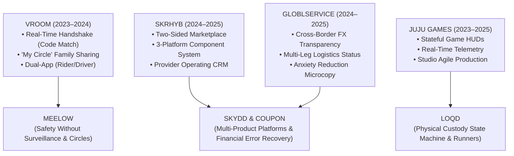

# Earlier Systems & Production Archive: VROOM, SKRHYB & GLOBLSERVICE

> **Selected commercial systems, two-sided marketplaces, and mobility platforms engineered between 2023 and 2025—establishing the foundations of multi-tenant architecture, trust handshakes, and cross-border logistics.**

---

## ⚡ Section Overview (The 60-Second Scan)

Before architecting enterprise insurtech platforms at Skydd and founding LOQD, my design foundation was forged across high-growth mobility, service marketplaces, and international commerce:
1. **VROOM (Mobility & Safety):** A two-sided ride-hailing ecosystem (Rider & Driver apps) balancing physical safety protocols (Security Code Matching, Panic Workflows, "My Circle" live trip sharing) with gamified progression engines.
2. **SKRHYB (Two-Sided Marketplace):** A dual-sided platform serving service consumers and professional providers—built from scratch with a unified design system deployed across 3 platforms within an 8-week MVP timeline.
3. **GLOBLSERVICE (Cross-Border Commerce):** A localized global procurement and logistics concierge helping African consumers purchase from international retailers (Amazon, eBay, Zara) by removing foreign payment blocks, customs opacity, and shipment anxiety.

---

```
┌────────────────────────────────────────────────────────────────────────────────────────────────────────┐
│                                   THE 9-ARTIFACT RETROSPECTIVE MAP                                     │
├────────────────────────────────────────────────────────────────────────────────────────────────────────┤
│ 01. VROOM: Dual-App Split (Rider vs. Driver UI)│ 06. SKRHYB: Multi-Platform Component Library          │
│ 02. VROOM: Security Code Handshake & Panic Flow│ 07. GLOBLSERVICE: "Paste-a-Link" Intake Interface     │
│ 03. VROOM: Gamified Progression & Driver XP    │ 08. GLOBLSERVICE: Localized Transparent Cost Engine   │
│ 04. SKRHYB: Dual-User Architecture (Provider/C)│ 09. GLOBLSERVICE: Live Multi-Leg Customs Tracker      │
│ 05. SKRHYB: Sub-60s Booking & Discovery Flow   │                                                       │
└────────────────────────────────────────────────────────────────────────────────────────────────────────┘
```

---

# Archive 01: VROOM — Mobility, Trust & Gamification

**Role:** Lead Product Designer  
**Timeline:** Aug 2023 – Aug 2024  
**Scope:** Dual Mobile Applications (Rider App & Driver App), Component Library, Trust & Emergency Systems  
**Domain:** Urban Transportation, Real-Time Mobility, Two-Sided Marketplace

```
┌─────────────────┬──────────────────────────────────────────────────────────────────────────────────────┐
│ The Challenge   │ Urban mobility in Nigerian cities suffers from driver impersonation, kidnapping      │
│                 │ fears, and high driver churn due to opaque daily earnings models.                    │
├─────────────────┼──────────────────────────────────────────────────────────────────────────────────────┤
│ The Strategic   │ • Built the **Security Code Matching Handshake**: Rider and driver must verify a     │
│ Solution        │   dynamic 4-digit PIN before the trip can physically start.                          │
│                 │ • Engineered **"My Circle" Live Trip Sharing**: Automated live route sharing with    │
│                 │   trusted family contacts (the behavioral prototype for Meelow).                     │
│                 │ • Designed a **Dual-Sided Progression System**: Driver visual earnings feedback with │
│                 │   XP milestones to drive retention, paired with rider loyalty tiers.                 │
└─────────────────┴──────────────────────────────────────────────────────────────────────────────────────┘
```

### Core Visual Artifacts:
> 🖼️ **[IMG_RETRO_01: VROOM_DUAL_APP_SPLIT]**  
> *Format: 16:9 (2400x1350px)*  
> *Content: Side-by-side view of the Rider home search interface alongside the Driver active dispatch and earnings dashboard.*

> 🖼️ **[IMG_RETRO_02: VROOM_SECURITY_HANDSHAKE]**  
> *Format: 16:10 (2560x1600px)*  
> *Content: The Security Code Matching modal on arrival, the in-trip emergency Panic Button workflow, and the "My Circle" live family tracker.*

> 🖼️ **[IMG_RETRO_03: VROOM_GAMIFIED_PROGRESSION]**  
> *Format: 16:10 (2560x1600px)*  
> *Content: Driver XP tiering, daily milestone bonus progress rings, and rider loyalty reward badges.*

---

# Archive 02: SKRHYB — Two-Sided Service Marketplace

**Role:** Product Designer (The Cypha)  
**Timeline:** Feb 2024 – Feb 2025  
**Scope:** Mobile & Web Application, 3-Platform Design System, Information Architecture  
**Domain:** On-Demand Services, Dual-Tenant Architecture, Provider CRM

```
┌─────────────────┬──────────────────────────────────────────────────────────────────────────────────────┐
│ The Challenge   │ Consumers needed frictionless booking in under 60 seconds; local service providers  │
│                 │ needed a business operating system (catalog, schedules, invoicing, subscriber data). │
├─────────────────┼──────────────────────────────────────────────────────────────────────────────────────┤
│ The Strategic   │ • Architected a **Dual-User Information Framework**: One unified design system       │
│ Solution        │   powers both consumer booking and provider business management across 3 platforms.  │
│                 │ • Delivered an **8-Week MVP**: Streamlined onboarding resulting in sub-60-second     │
│                 │   first-time booking completion during user testing.                                 │
│                 │ • Built **Modular Component Library**: Standardized form inputs, calendar booking    │
│                 │   pickers, and review summary cards used across web, iOS, and Android.               │
└─────────────────┴──────────────────────────────────────────────────────────────────────────────────────┘
```

### Core Visual Artifacts:
> 🖼️ **[IMG_RETRO_04: SKRHYB_DUAL_USER_ARCHITECTURE]**  
> *Format: 16:9 (2400x1350px)*  
> *Content: User journey map and sitemap showing the bifurcation between the Consumer Discovery Portal and the Provider Business Management CRM.*

> 🖼️ **[IMG_RETRO_05: SKRHYB_SUB_60S_BOOKING_FLOW]**  
> *Format: 16:10 (2560x1600px)*  
> *Content: Step-by-step consumer booking progression: Service category picker, verified provider profile, calendar slot selection, and checkout sheet.*

> 🖼️ **[IMG_RETRO_06: SKRHYB_MULTI_PLATFORM_DESIGN_SYSTEM]**  
> *Format: 16:9 (2400x1350px)*  
> *Content: Scalable Figma component sheet showing responsive auto-layout cards, calendar pickers, provider analytics charts, and unified tokens.*

---

# Archive 03: GLOBLSERVICE — Cross-Border Logistics & Procurement

**Role:** Product Designer (The Cypha)  
**Timeline:** Feb 2024 – Feb 2025  
**Scope:** Mobile & Responsive Web Experience, Order Logistics Architecture  
**Domain:** Cross-Border E-Commerce, Customs Tracking, African Consumer Procurement

```
┌─────────────────┬──────────────────────────────────────────────────────────────────────────────────────┐
│ The Challenge   │ Buying from global retailers (Amazon, Zara, eBay) from Africa is severely hindered   │
│                 │ by foreign card payment declines, complex freight forwarding, and customs black holes│
├─────────────────┼──────────────────────────────────────────────────────────────────────────────────────┤
│ The Strategic   │ • **The "Paste-a-Link" Intake Engine**: Simplified international purchasing into a   │
│ Solution        │   single input: paste any global product URL to generate instant local currency fees.│
│                 │ • **Zero-Hidden-Fee Price Transparency**: Replaced confusing freight shipping terms  │
│                 │   with an all-inclusive Naira breakdown (Product + Freight + Customs Clearance).     │
│                 │ • **Anxiety-Reducing Tracking Engine**: Localized human-centered tracking logs       │
│                 │   replacing raw carrier codes with clear status cues: *"We’ve got it. It’s cleared."*│
└─────────────────┴──────────────────────────────────────────────────────────────────────────────────────┘
```

### Core Visual Artifacts:
> 🖼️ **[IMG_RETRO_07: GLOBLSERVICE_PASTE_A_LINK_FLOW]**  
> *Format: 16:10 (2560x1600px)*  
> *Content: The single-input global procurement interface: URL input field, automatic metadata scraping (title, preview, USD price), and category selector.*

> 🖼️ **[IMG_RETRO_08: GLOBLSERVICE_COST_BREAKDOWN_SHEET]**  
> *Format: 16:10 (2560x1600px)*  
> *Content: The Transparent Quotation Modal: Currency conversion breakdown, local payment options, estimated doorstep delivery window, and customs clearance assurance.*

> 🖼️ **[IMG_RETRO_09: GLOBLSERVICE_MULTI_LEG_TRACKER]**  
> *Format: 16:9 (2400x1350px)*  
> *Content: The localized tracking interface: Multi-leg status progression (`Procured in US` ➔ `In Flight` ➔ `Customs Cleared at Lagos MMIA` ➔ `Out for Delivery`).*

---

## 💡 The Architectural Thread: How Earlier Work Informs Current Mastery



These three projects are not disconnected relics; they are the **empirical foundation** of my design methodology. The safety verification handshake from VROOM evolved into Meelow's emergency architecture. The multi-platform design systems of SKRHYB paved the way for Skydd's 8-product componentry. And the cross-border financial transparency of GLOBLSERVICE informed Coupon’s regulatory deposit modeling.
