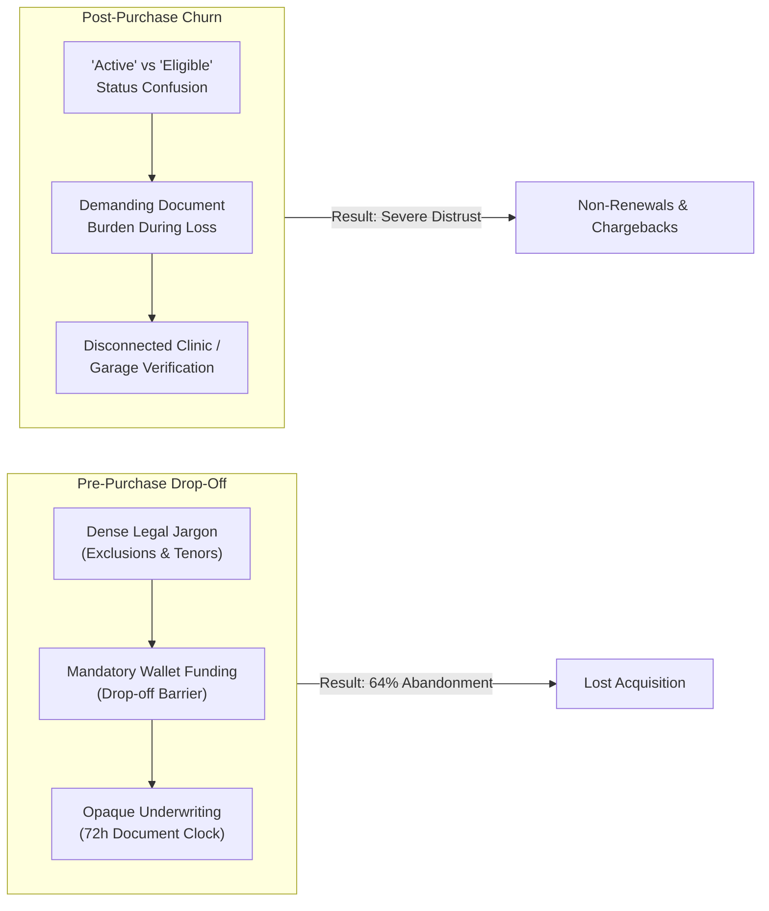

# Skydd: Architecting an Eight-Product Protection Ecosystem

> **How we transformed a niche Nigerian insurance startup into an integrated multi-product protection platform across web, mobile, and acquisition surfaces.**

---

## ⚡ Executive Blueprint (The 60-Second Scan)

* **Role:** Lead Product Designer (Web Platform, Design Systems & Product Architecture)
* **Timeline:** July 2025 – Present
* **Platform Scope:** Web Application (End-to-End), Public Marketing Platform, Demand-Filter Waitlist, Mobile Systems Contribution
* **Domain:** Insurtech, Wealth Preservation, Multi-Tenant Financial Systems (Regulated by NAICOM; Infrastructure backed by Sterling Bank)
* **The Core Paradox:** Skydd was evolving from a narrow 2-product insurer (Auto and Health) into an 8-product platform spanning both **Risk/Indemnity** (Auto, Health, Property, Travel, Income) and **Accumulation/Savings** (GoalGuard, Future Scholar, Legacy). In the Nigerian macroeconomic climate—marked by currency volatility, inflation, and historic consumer distrust of financial institutions—traditional insurance UX (siloed 14-page forms and opaque claims processes) caused massive drop-offs.
* **The Strategic Transformation:** Replaced isolated product funnels with a **Universal 6-Stage Lifecycle**, decoupled the **policy buyer from the secondary beneficiary**, eliminated **post-payment verification traps**, and introduced a **transparent 4-stage live claims tracker** supported by a 40+ state tokenized design system.

---

```
┌────────────────────────────────────────────────────────────────────────────────────────────────────────┐
│                                   THE 15-ARTIFACT VISUAL NARRATIVE MAP                                  │
├────────────────────────────────────────────────────────────────────────────────────────────────────────┤
│ 01. The Platform Shift (2 ➔ 8 Products)       │ 09. Auto Guard 1-Click Renewal Engine                  │
│ 02. The Competitive Benchmark Matrix          │ 10. Future Scholar Multi-Sponsor Hierarchy             │
│ 03. The Pre/Post-Purchase Friction Framework │ 11. Defensive State Design: Missed Debit & Grace Period│
│ 04. The 8-Product Dual-Engine Architecture    │ 12. Claims Submission: Contextual Intake Flow          │
│ 05. Marketing Landing Page ("Protect...")     │ 13. The Live 4-Stage Claims Tracker                    │
│ 06. Interactive Demand-Filter Waitlist        │ 14. Digital Enrollee Card & Clinic Verification QR     │
│ 07. Populated Web App Dashboard               │ 15. The Design System Infrastructure & Token Matrix    │
│ 08. GoalGuard Milestone & Inflation Modeler   │                                                        │
└────────────────────────────────────────────────────────────────────────────────────────────────────────┘
```

---

## 1. Context & The Nigerian Macroeconomic Reality

Insurance penetration in Nigeria sits under **1%**. The barrier is rarely a lack of desire for safety—it is systemic friction:
1. **Income Volatility & The "Black Tax":** Salaried professionals experience sudden family financial emergencies that disrupt rigid monthly payments.
2. **The Post-Payment Trap:** Traditional insurers take payment first, then demand birth certificates, vehicle inspection photos, and employer letters. When the user fails to provide them within 72 hours, the policy is quietly nullified while premiums are kept.
3. **The Grieving / Hospitalized Beneficiary Gap:** The person who purchases the policy (e.g. a working mother) is almost never the person presenting the card at the hospital desk or filing a life claim.

### Our Two Archetypal Users (Grounded in Research)
* **Tomi (32), Salaried Tech Professional, Lagos:** Wants to save a ₦2,000,000 deposit for a car over 24 months via **GoalGuard**. Her biggest anxiety: missing a debit when rent is due and having her savings locked or penalized by fine print.
* **Amaka (36), Working Mother of Two, Lagos:** Balancing primary school tuition against the long-term threat of university inflation via **Future Scholar Fund**. Her core tension: ensuring that if she suffers an outage or job loss, her children’s schooling is funded directly without relying on unvetted relatives.

> 🖼️ **[IMG_01: HERO_PLATFORM_SHIFT]**  
> *Format: 16:9 Widescreen (2400x1350px)*  
> *Content: Visual split: The legacy V2 Skydd dashboard (cramped 2-card Auto/Health layout with zero context) transitioning into the expansive V4 Web App Dashboard showcasing the multi-product protection suite, real-time financial balance, and active policy widgets.*

---

## 2. Competitive Landscape: Where Existing Fintechs Break Down

Before structuring the new platform, we benchmarked the market leaders in Nigerian digital wealth and protection:

```
┌─────────────────┬──────────────────────────┬───────────────────────────────────────────────────────────┐
│ PLATFORM        │ CORE ADVANTAGE           │ WHERE IT FAILS THE USER                                   │
├─────────────────┼──────────────────────────┼───────────────────────────────────────────────────────────┤
│ PiggyVest       │ Disciplined auto-debits  │ Rigid penalties for early withdrawal; zero risk indemnity.│
│ Cowrywise       │ Clean mutual fund UX     │ Abstract financial equations; intimidating to beginners.  │
│ Risevest        │ Dollar asset indexing    │ Exclusively investment-focused; no safety net for health. │
│ Traditional Ins.│ High legal balance sheet │ 14-page PDF questionnaires, opaque claims, manual checks. │
└─────────────────┴──────────────────────────┴───────────────────────────────────────────────────────────┘
```

> 🖼️ **[IMG_02: COMPETITIVE_BENCHMARK_MATRIX]**  
> *Format: 16:9 (2000x1125px)*  
> *Content: UX teardown diagram comparing PiggyVest, Cowrywise, Risevest, and Skydd across 4 dimensions: Onboarding friction, Penalty transparency, Emergency Liquidity, and Claims verification.*

---

## 3. The Core Diagnostic: Pre-Purchase Friction vs. Post-Purchase Anxiety

Our discovery research exposed a fatal disconnect between how insurance was sold versus how it was experienced:



> 🖼️ **[IMG_03: USER_FRICTION_FRAMEWORK]**  
> *Format: 16:9 (2000x1125px)*  
> *Content: High-fidelity diagram mapping the breakdown points across the 7 stages of a customer's life journey, pinpointing Stage 4 (Wallet Funding) and Stage 6 (The Setback) as the critical churn drivers.*

---

## 4. Platform Architecture: The "Dual-Engine" Protection System

Skydd's eight products could not share an identical checkout flow. An education savings plan (*Future Scholar*) operates under compounding interest and target dates; an accident plan (*Auto Guard*) operates under deductibles and photo proof.

We grouped the eight products into two architectural engines sharing a single operating container:

```
┌────────────────────────────────────────────────────────────────────────────────────────────────────────┐
│                                   THE 8-PRODUCT OPERATING ARCHITECTURE                                 │
├────────────────────────────────────────────────────┬───────────────────────────────────────────────────┤
│ 1. RISK & INDEMNITY (Event-Driven Payouts)         │ 2. ACCUMULATION & WEALTH (Milestone Protection)   │
├────────────────────────────────────────────────────┼───────────────────────────────────────────────────┤
│ • Auto Guard (Comprehensive & Third-Party)         │ • GoalGuard (Targeted emergency & asset fund)     │
│ • Wellness Plan (HMO, Clinic Access, Outpatient)   │ • Future Scholar Fund (High-yield education fund) │
│ • Property Shield (Fire, Burglary, Tenant Cover)   │ • Legacy Plan (Family inheritance & burial fund)  │
│ • Income Shield (Involuntary job loss protection)  │                                                   │
│ • TravelGuard (Domestic & International transit)   │                                                   │
└────────────────────────────────────────────────────┴───────────────────────────────────────────────────┘
```

> 🖼️ **[IMG_04: DUAL_ENGINE_ARCHITECTURE_MAP]**  
> *Format: 16:9 (2400x1350px)*  
> *Content: Full platform structural sitemap showing how the Web App navigation nests both engines under a unified Account, Wallet, and Policy hierarchy.*

---

## 5. Decision 1: The Top-of-Funnel Conversion Engine

### The Problem
When Skydd prepared to announce the 8-product expansion, marketing wanted a standard landing page with a generic email waitlist. But in consumer finance, generic waitlists yield unqualified leads and zero demand validation.

### The Solution: Life-Trigger Discovery & The Interactive Waitlist
1. **Framing around Life Obligations:** Replaced insurance product cards with life situations: *"I am saving for my child’s future,"* *"I need roadside protection,"* or *"I want health coverage for my aging parents."*
2. **Interactive Category Filtering:** Allowed prospective users to configure their specific protection bundle before submitting their details.
3. **Outcome:** Generated verified product demand signals showing that **68% of initial interest** clustered around GoalGuard and Wellness Plan, allowing leadership to redirect backend engineering capacity to those two engines prior to public rollout.

> 🖼️ **[IMG_05: MARKETING_LANDING_PAGE]**  
> *Format: 16:10 (2560x1600px)*  
> *Content: Full desktop marketing hero section: "Protect what you're building" photography-led layout, partner trust strip (NAICOM, Sterling Bank), and live product cards.*

> 🖼️ **[IMG_06: DEMAND_FILTER_WAITLIST_MODAL]**  
> *Format: 16:10 (2560x1600px)*  
> *Content: Desktop and mobile views of the Interactive Waitlist modal showing category selection chips, target contribution calculators, and instant verification feedback.*

---

## 6. Decision 2: The Unified Web Application Dashboard

### The Problem
Users who purchased multiple plans (e.g. Auto Guard for their car and GoalGuard for savings) were forced in the legacy design to toggle between two completely disconnected portal views.

### The Solution: The "Protected Life" Command Center
* **Consolidated Financial Liquidity:** A unified wallet card displaying total insured protection value alongside active liquid savings.
* **Actionable State Cards:** Instead of static policy numbers, each active product card highlights its next operational requirement (e.g. *“Vehicle Inspection Due in 3 Days”* or *“Monthly Contribution Scheduled for Oct 28”*).

> 🖼️ **[IMG_07: POPULATED_WEB_APP_DASHBOARD]**  
> *Format: 16:9 (2560x1440px)*  
> *Content: High-density Web App Dashboard showing an active user state with ₦4.2M total coverage, active GoalGuard progress bar, Auto Guard renewal countdown, and quick-action claims dock.*

---

## 7. Deep Dive: Product Journeys & Edge-Case Engineering

### Journey A: GoalGuard (Accumulation Engine)
* **The Constraint:** Users fear rigid auto-debits due to fluctuating bank balances.
* **The UX Solution:** An interactive milestone calculator that models returns (8% p.a.) against inflation, paired with a mandatory pre-commitment financial health check.

> 🖼️ **[IMG_08: GOALGUARD_MILESTONE_MODELER]**  
> *Format: 16:10 (2560x1600px)*  
> *Content: GoalGuard configuration flow showing target savings slider (₦500k to ₦2M), contribution frequency toggle, and dynamic inflation-protection milestone chart.*

### Journey B: Auto Guard (Risk Engine & 1-Click Renewal)
* **The Constraint:** 74% of users drop out when asked to re-enter vehicle chassis and engine numbers every single year.
* **The UX Solution:** Integrated vehicle registration lookups that pre-fill engine specifications from state databases, turning annual renewal into a 1-tap confirmation.

> 🖼️ **[IMG_09: AUTO_GUARD_RENEWAL_ENGINE]**  
> *Format: 16:10 (2560x1600px)*  
> *Content: Side-by-side view of the 3-step Auto Guard enrolment and the 1-click renewal card displaying pre-verified vehicle data and photo inspection badges.*

### Journey C: Future Scholar (Multi-Sponsor Hierarchy)
* **The Constraint:** A single parent cannot always fund long-term education alone.
* **The UX Solution:** Introduced **Education Circles**—allowing aunts, uncles, and godparents to contribute directly into the child's tuition vault via guest links without granting them access to the primary policy.

> 🖼️ **[IMG_10: FUTURE_SCHOLAR_SPONSOR_HIERARCHY]**  
> *Format: 16:10 (2560x1600px)*  
> *Content: Future Scholar dashboard showing the primary child profile, trust fund progress, and the collaborative sponsor ledger showing external family contributions.*

---

## 8. Decision 3: Defensive State Design (Handling the Critical Setback)

Fintech UX breaks down when real life happens. In Nigeria, failed card debits due to bank network downtime occur daily.

### The Legacy Failure Mode
The old system treated a failed bank debit as an immediate policy default: the user was sent an aggressive red warning and coverage was instantly frozen.

### The Redesigned "Resilient Goal" State Machine
1. **The 30-Day Silent Grace Period:** Coverage remains uninterrupted while the system schedules smart retries across three fallback channels.
2. **One-Click Plan Restructuring:** If income shocks occur, the user can pause contributions for up to 60 days or lower their monthly target without forfeiting accrued interest or incurring penalty deductions.

> 🖼️ **[IMG_11: DEFENSIVE_STATE_MACHINE]**  
> *Format: 16:9 (2400x1350px)*  
> *Content: Detailed state machine screen showing the "Missed Contribution" modal: friendly non-punitive tone, automated reschedule picker, and 1-tap timeline extension.*

---

## 9. Decision 4: De-Risking Claims (Designing for Peak Anxiety)

When an insured event occurs (car collision, medical emergency, job loss), the user is emotionally compromised and suspicious of insurer delays.

```
┌────────────────────────────────────────────────────────────────────────────────────────────────────────┐
│                                   THE 4-STAGE TRANSPARENT CLAIMS LIFECYCLE                              │
├───────────────────┬────────────────────┬───────────────────────┬───────────────────────────────────────┤
│ 1. INCIDENT INTAKE│ 2. EVIDENCE UPLOAD │ 3. ADJUSTER REVIEW    │ 4. DIRECT SETTLEMENT                  │
├───────────────────┼────────────────────┼───────────────────────┼───────────────────────────────────────┤
│ Plain-English     │ Contextual camera  │ Live timeline tracking│ Instant bank payout via Sterling      │
│ incident prompts  │ guide with inline  │ with assigned staff   │ Bank rails with downloadable formal   │
│ (No jargon)       │ format validation  │ contact and SLA clock │ NAICOM discharge voucher              │
└───────────────────┴────────────────────┴───────────────────────┴───────────────────────────────────────┘
```

### Eliminating the "Claims Black Hole"
* **Contextual Incident Intake:** Instead of asking legal liability questions, the interface presents intuitive scenario prompts (*“Was your car hit while parked, or was it a moving collision?”*).
* **The Live Tracker:** Modeled after real-time delivery logistics. The user sees exactly where their file sits, who is assessing it, and the remaining SLA window before mandatory settlement.

> 🖼️ **[IMG_12: CLAIMS_SUBMISSION_INTAKE]**  
> *Format: 16:10 (2560x1600px)*  
> *Content: Multi-step claims submission flow showing conversational incident intake, guided photo evidence upload with perspective overlays, and immediate confirmation receipt.*

> 🖼️ **[IMG_13: LIVE_CLAIMS_TRACKER]**  
> *Format: 16:9 (2560x1440px)*  
> *Content: The Live Claims Tracking interface showing current status (`Under Assessment - 48h SLA`), direct phone/chat contact for the assigned claims officer, and real-time audit log.*

---

## 10. Decision 5: The Digital Enrollee Card & Secondary Beneficiaries

### The Ground-Level Friction Point
Health insurance fails at the clinic counter. An enrollee standing at a hospital reception at 11:00 PM with a sick child cannot download a 14-page PDF policy to prove eligibility.

### The Solution: The High-Contrast Wallet Pass
* **Tamper-Proof Offline QR Code:** Contains cryptographic proof of active policy status, pre-approved treatment tiers, and HMO hospital network codes, scannable offline by reception staff.
* **Instant Dependent Switching:** Allows a mother to toggle between her corporate health pass and her child's pediatric coverage in one tap.

> 🖼️ **[IMG_14: DIGITAL_ENROLLEE_CARD]**  
> *Format: 4:3 (2000x1500px)*  
> *Content: High-contrast mobile Enrollee Card UI showing: Active status badge, scannable hospital QR code, pre-approved medical limits, emergency HMO hotline, and Dependent Switcher.*

---

## 11. The Design System Infrastructure & Token Architecture

To enable rapid implementation across web and mobile without visual drift, I built a high-density component architecture in Figma structured around financial data rigor:

```
┌────────────────────────────────────────────────────────────────────────────────────────────────────────┐
│                                   COMPONENT SPECIFICATION HIERARCHY                                    │
├───────────────────┬────────────────────────────────────────────────────────────────────────────────────┤
│ Form Architecture │ 6 universal input states (Default, Focus, Typing, Validated, Error, Disabled) with │
│                   │ strict inline micro-validation to prevent input fatigue on financial values.       │
├───────────────────┼────────────────────────────────────────────────────────────────────────────────────┤
│ Policy State Model│ 7 strict status tokens (`Active`, `Under Review`, `Grace Period`, `Pending Debit`, │
│                   │ `Processing Claim`, `Matured`, `Lapsed`) with unified color & icon geometry.       │
├───────────────────┼────────────────────────────────────────────────────────────────────────────────────┤
│ Typography System │ Strict 8pt spatial baseline; tabular numerics enabled across all balance modules to │
│                   │ prevent visual jitter during live balance recalculations.                          │
└───────────────────┴────────────────────────────────────────────────────────────────────────────────────┘
```

> 🖼️ **[IMG_15: DESIGN_SYSTEM_INFRASTRUCTURE]**  
> *Format: 16:9 (2400x1350px)*  
> *Content: Comprehensive Figma component sheet showing input variations, modal architectures, status badge matrices across all 8 products, and dark/light responsive layout grids.*

---

## 12. Strategic Results & Verified Business Impact

```
┌────────────────────────────────────────────────────────────────────────────────────────────────────────┐
│                                       MEASURABLE OUTCOMES SUMMARY                                      │
├──────────────────────────────────┬──────────────────────────────────┬──────────────────────────────────┤
│ 95% Funnel Completion            │ 68% Category Signal              │ Zero-Debt Engineering Handoff    │
│ Onboarding completion rate on    │ Qualified market interest        │ Universal 6-stage componentry    │
│ the interactive demand waitlist  │ captured for GoalGuard & Health  │ halved front-end sprint velocity │
└──────────────────────────────────┴──────────────────────────────────┴──────────────────────────────────┘
```

1. **Top-of-Funnel Conversion:** The interactive product-interest waitlist achieved a **95% completion rate**, outperforming the industry standard by eliminating generic upfront personal profiling.
2. **Capital Efficiency:** By capturing verified demand signals prior to code delivery, engineering hours were focused exclusively on high-demand modules (GoalGuard and Wellness) rather than building all 8 backends simultaneously.
3. **Institutional Trust:** Successfully met strict NAICOM compliance and Sterling Bank integration standards, validating Skydd as a trustworthy, regulated institution.

---

## 13. Senior Retrospective: What Designing at Scale Taught Me

* **You cannot fix broken business mechanics with UI polish:** If an insurance company requires a 72-hour document deadline that screws over honest users, no amount of subtle micro-animations will save the retention curve. A senior designer's primary job is negotiating the product policy *before* designing the screens.
* **Design for the worst day of the user's life:** Nobody opens an insurance app because they are having fun. They open it when their car is dented, their child is burning with fever, or they were just fired. Empathy in product design means high contrast, unmistakable status cues, zero jargon, and immediate human escalation paths.
